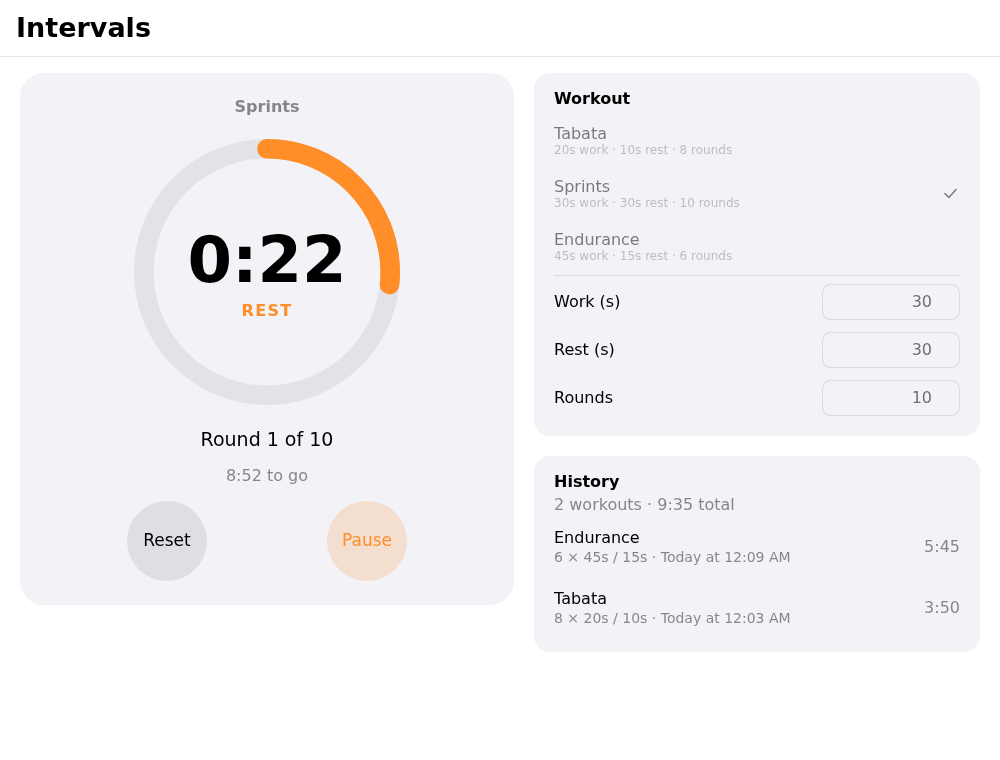
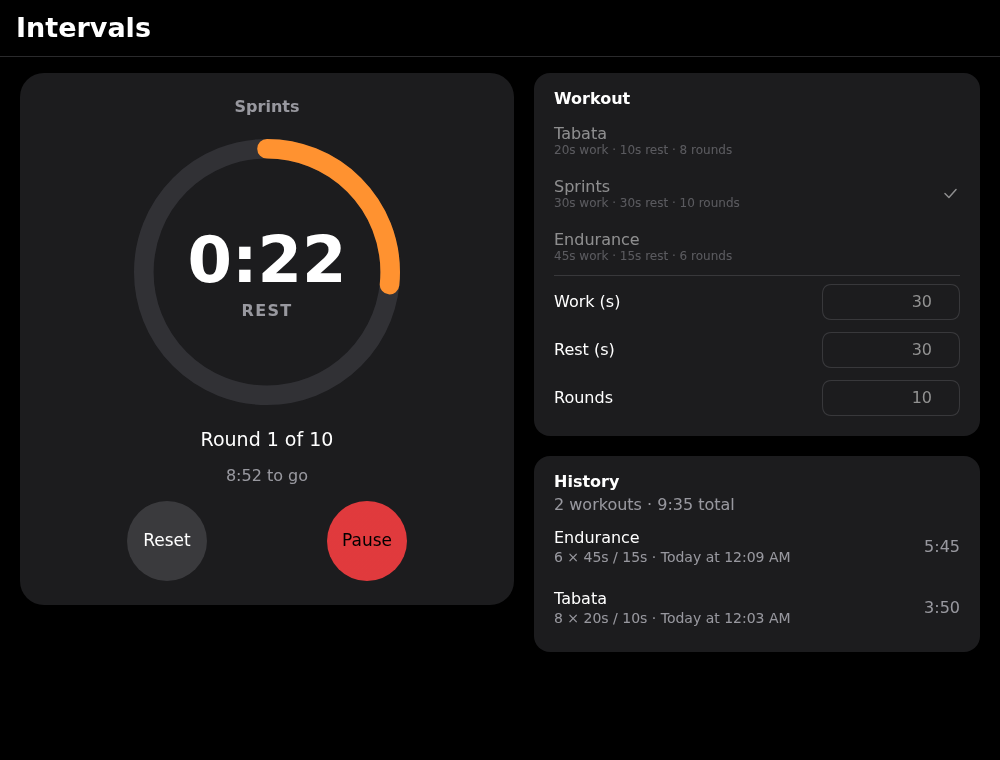
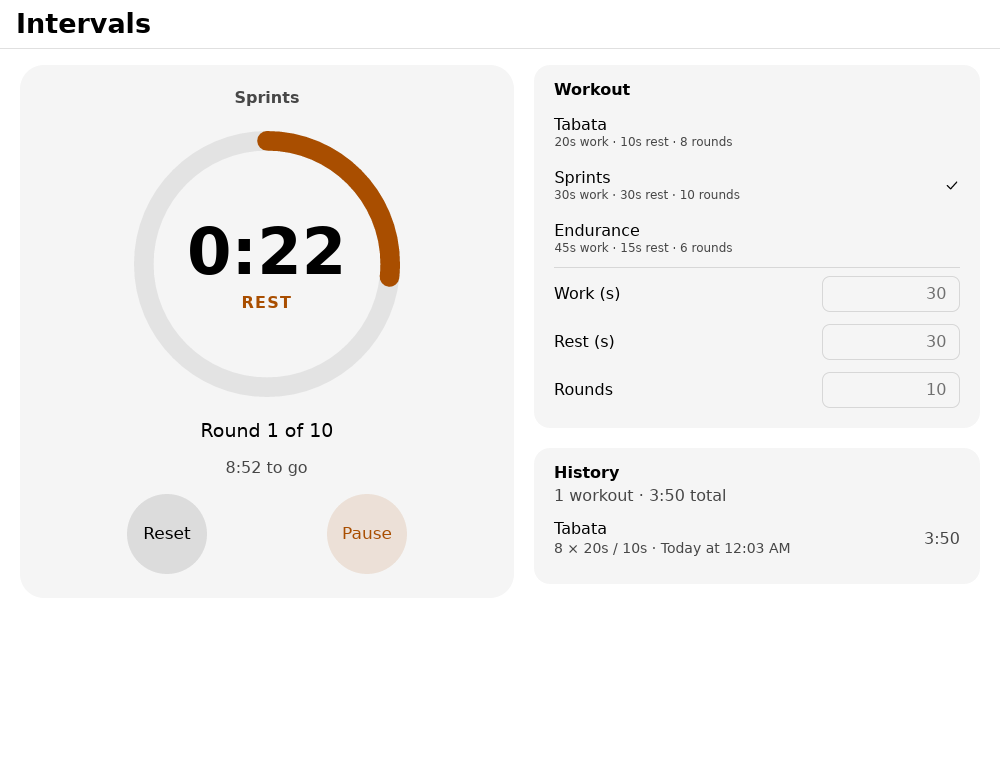

# Intervals

An interval-workout timer built with [Exact](https://github.com/expo/exact), Expo's agent-native app framework. One Contract file is the whole app; it runs natively on the web, macOS, iOS and Linux, and an AI agent can build it, drive it, see it and test it on every one of them.

| Light | Dark |
| --- | --- |
|  |  |

The same contract on the native Linux host (Rust, no browser), driven by the same agent script:



## What it shows off

Timers are the classic thing UI tests can't test well: you either wait in real time or mock the clock and hope the mock matches the platform. Exact's agent owns the app's clock instead, so the same script runs a full workout deterministically, in about a second, on every host:

```contract-test
test "a whole Tabata finishes and is logged to history"
  clock data
  tap "start"
  clock +235000          // 5 seconds to get ready + 3:50 of workout, instantly
  clock data
  expect text "phase" == "DONE"
  expect text "history-summary" == "1 workout · 3:50 total"
  reload                 // a relaunch keeps the history
  clock data
  expect text "history-summary" == "1 workout · 3:50 total"
```

- **One typed Contract app** ([app.contract](app.contract)): state, derived values, the ticking task, actions and the view in ~220 lines. The countdown is derived from a start mark and `performanceNow()`, never by counting ticks, so it can't drift and a virtual-clock jump lands exactly.
- **A tiny TypeScript data source** ([app.ts](app.ts)): finished workouts are appended to a JSON file through Exact's sandboxed storage grant; the view never sees I/O, only typed `History` and `Reply` shapes generated from the contract.
- **First-workout friendly**: each preset has a short explanation. Start and Again include a five-second Get ready countdown, excluded from workout history. Pause keeps the current phase and Resume continues it without another lead-in.
- **Platform-native by default**: colours, fonts, control metrics and the safe area are left unsaid, so each host supplies its own; dark mode, the responsive two-column layout and accessibility (`role="timer"` with a spoken label) come with it. Phase changes and completion play a short declared WAV through Exact's `playSound` API and a haptic where supported. Web audio unlocks after the first tap or key; Linux and Windows record sound commands without playing them.
- **`bun exact.mjs verify` is clean**: beyond the tests, it checks every test's end screen at phone and desktop sizes in light and dark for contrast, overflow at the largest text size and state that should survive a reload, then random-walks the contract's actions. Its findings (low-contrast tinted buttons, unwrapped rows at huge text, custom settings lost on reload) shaped the final app.
- **Describe your workout**: type plain words above the presets, review the live preview, then tap **Set up timer** to fill the Custom fields. Nothing starts until you tap Start. For example, try `8 rounds of 40 on 20 off` or `10 x 1 min hard, 30s easy`.
- **Agent-driven tests** ([app.test.contract](app.test.contract)): 30 tests tap, type and read the screen by `testId`, covering plain-word previews/apply, validation, preparation, work/rest transitions and sound, pause/resume, reset, reload/suspension recovery, zero-rest workouts, long durations and persisted history. Parser unit tests are in [workout.test.ts](workout.test.ts) (`bun test workout.test.ts`).

### Plain-word workouts

The local parser understands rounds/times/sets/reps/intervals, `8x`, `8 x` or `x8`, and number words one–twenty. Durations accept seconds (including bare numbers), minutes (including decimals), `1:30`, `a minute` and `half a minute`. Pair work/rest with on/off, work/rest, hard/easy, fast or sprint / slow, jog, walk, recover, recovery or break; keywords can precede the durations. Slash or comma pairs work too. A single duration with rounds means zero rest; `no rest`, `no break` and `straight` explicitly request it. `tabata` supplies 20s/10s × 8 and accepts overrides.

With work/rest but no rounds, `for N minutes` picks the largest whole number of rounds that fits, excluding the last rest. Previews use the timer's total (no trailing rest); work must be 1–600 whole seconds, rest 0–600, rounds 1–99. Unsupported or out-of-range descriptions cannot be applied. Multiple sets with between-set rest, ladders/pyramids, several different intervals, EMOM/AMRAP and per-round exercise names are intentionally unsupported.

## Run it

Exact expects its checkout beside this one and Bun 1.4.2:

```sh
git clone https://github.com/expo/exact ../exact
(cd ../exact && bun scripts/exact.mjs setup)

bun exact.mjs web          # dev server with live reload
bun exact.mjs test web     # the agent-driven tests in headless Chrome
bun exact.mjs linux        # the native Linux host (also: ios --run, mac --run)
```

Drive it yourself the way the tests do, and look at the result:

```sh
bun exact.mjs agent web --storage demo "tap start" "clock +12000" "screenshot work.png" tree
```

On Linux without Playwright's Chromium, point `CHROME` at any Chrome binary. Exact's prebuilt Hermes needs glibc 2.36 or newer, so on Ubuntu 22.04 build the Linux host in a newer distro (e.g. a `debian:trixie` container).
